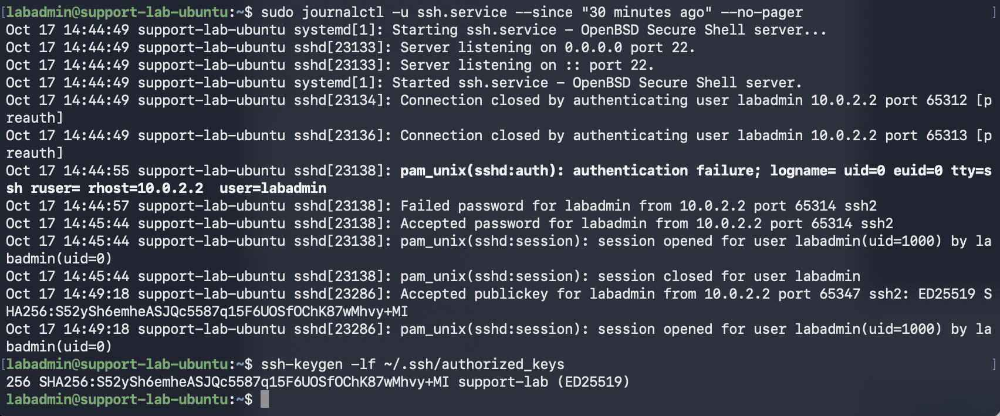

# SSH Key Authentication

## Goal
Configure SSH public-key authentication from my Mac to the Ubuntu server, keeping the private key on my Mac.
## Evidence
Observed an Accepted publickey log entry. Its fingerprint matched my Mac’s lab public key and the single entry in Ubuntu’s authorized_keys. The successful authentication demonstrated possession of the matching private key; the file entry alone only showed that the public key was authorized.
## Troubleshooting
I initially searched for authorized_keys on my Mac and received “No such file or directory.” I used whoami, hostname, and pwd to identify the machine and account, then repeated the check in my Ubuntu SSH session.
## Conclusion
Verified that my Mac successfully authenticated as labadmin using the intended SSH key. Password authentication remains enabled; this test did not configure key-only access.

## Permissions verification

I inspected SSH file permissions using `ls -ld` on Ubuntu and
`ls -l` on my Mac.

| Location | File or directory | Owner | Permissions |
|---|---|---|---|
| Ubuntu | ~/.ssh | labadmin | 700 (drwx------) |
| Ubuntu | ~/.ssh/authorized_keys | labadmin | 600 (-rw-------) |
| Mac | ~/.ssh/id_ed25519_support_lab | suyoungkwak | 600 (-rw-------) |

These permissions give the owner access and grant no permissions
to the group or other users. No permission changes were needed.

The private key must be protected from unauthorized reading because
someone who copies it could impersonate the client if they can unlock
it with its passphrase.

The authorized_keys file must be protected from unauthorized changes
because someone could add their own public key and potentially gain
access using their corresponding private key. Removing an existing
entry could also revoke that key's access for new logins.

## Screenshot

